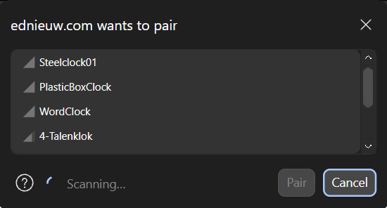
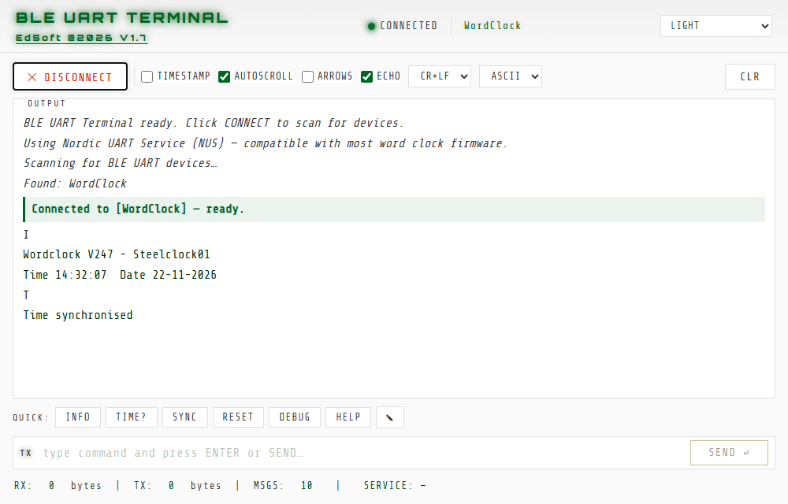
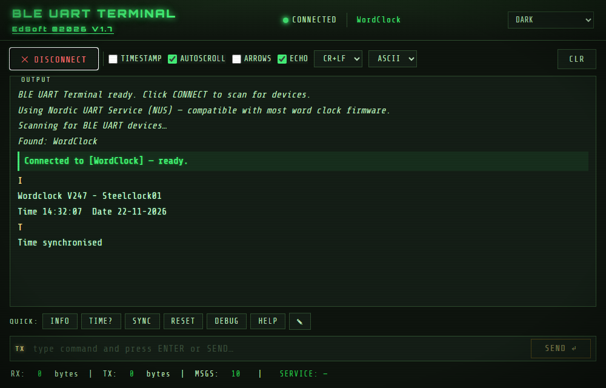
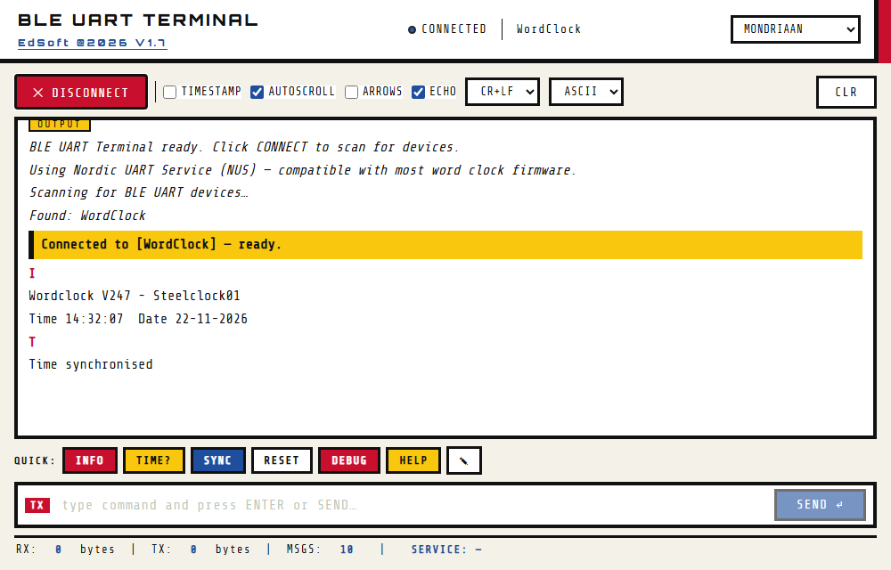
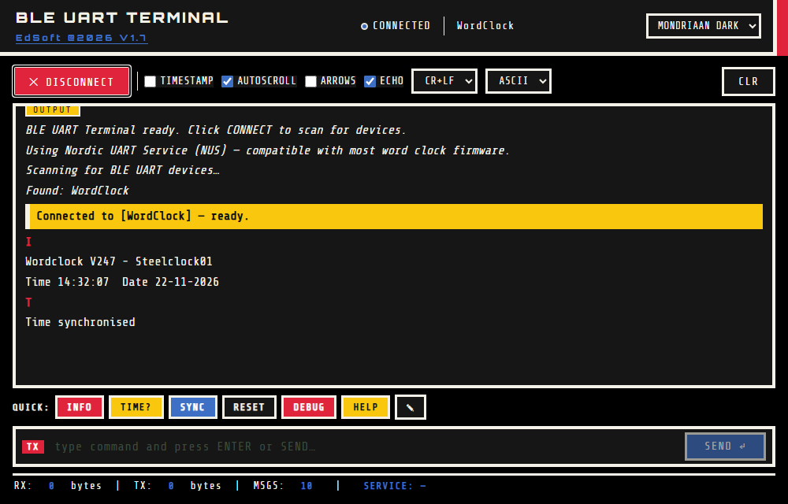

# HTML-BLEserial

[Version controlled BLE_UART_Terminal on ednieuw.github.io](https://ednieuw.github.io/HTML-BLEserial/BLE_UART_Terminal.html)

I keep a non version controlled version to control [my wordclocks](https://github.com/ednieuw/Arduino-ESP32-Nano-Wordclock) on my web site here: [BLE_UART_Terminal V1.7](https://ednieuw.com/BLESerial/BLE_UART_Terminal.html)

To control microprocessors via a serial port or Bluetooth a serial terminal is used. A serial terminal sends and receives ASCII characters.<br> 
When a BLE device uses the TI CC2541 (HM-10, HM-16, JDY modules) or a Nordic nRF52 chipset (all ESP32s MCU's), [an app on a phone or tablet](https://ednieuw.com/BLESerial/IOSappMain.html) can be installed and used. <br>

Since 2025, browsers like Chrome and Edge can simulate a serial terminal via BLE directly, without installing any app.<br>
It is still experimental and behaves different on Windows 11 and MacOS Tahoe.

With the iPhone and iPad this BLE-HTML serial terminal does not work without an extra app, Bluefy (2026).<br> 
In MacOS Tahoe and Windows 11 web-BLE does work.




When the Connect button is pressed some devices do not broadcast their name directly "Unknown or unsupported Device" 

This depends on the browser used and the OS of the computer. <br>

On MacOS Tahoe in Chrome  it works as expected but on my W11 PC from 2020 with a 6 year old Bluetooth it has to pair before showing its broadcast name.

After Pairing/connecting: Connect failed: GATT Server is disconnected. Cannot retrieve services. (Re)connect first with `device.gatt.connect`<br>

Connect again and it will connect.<br>
The broadcast name is then often displayed.  


[Open the Serial monitor from my web site](https://ednieuw.com/BLESerial/BLE_UART_Terminal.html)

---

## Themes

The theme can be chosen with the selector at the top right: **LIGHT**, **DARK**, **MONDRIAAN** and **MONDRIAAN DARK**. The Mondriaan themes are in the style of Piet Mondriaan: white and cream (or black) with thick grid lines and red, yellow and blue blocks. The choice is remembered in the browser.

**LIGHT**



**DARK**



**MONDRIAAN**



**MONDRIAAN DARK**



### Install as an app with its own icon

Open [BLE_UART_Terminal.html](https://ednieuw.com/BLESerial/BLE_UART_Terminal.html) in Chrome or Edge (Android, Windows, macOS) and choose **Install app**. The app starts like a normal app and also works without internet.

To host it as an installable PWA on your own server, upload `BLE_UART_Terminal.html`, `manifest.webmanifest`, `sw.js` (service worker) and `icons/` together into the same folder over `https://`. (Downloading `BLE_UART_Terminal.html` by itself still works as a standalone file.)

### Manuals

Scan the QR code in the manual or click a link:
- [Manual in English (PDF)](manual/Manual_BLE_UART_Terminal_UK.pdf)
- [Handleiding in het Nederlands (PDF)](manual/Handleiding_BLE_UART_Terminal_NL.pdf)
- QR code: [BLE UART Terminal](manual/qr-ble-uart-terminal.png)

---

## Requirements

- **Browser:** Chrome or Edge (desktop or Android). Safari and Firefox do not support Web Bluetooth.
- **OS:** Windows 10/11, macOS, Android. iOS is not supported by Chrome.
- **Device:** Any BLE UART device using the Nordic UART Service (NUS) UUIDs or TI CC2541-compatible UUIDs.

---

## Browser flags

If no devices appear or the connection fails, check that Web Bluetooth is enabled:

- In Chrome, type `chrome://flags` in the address bar
- In Edge, type `edge://flags`
- Search for `bluetooth`
- Make sure nothing is disabled.<br>On some versions `#enable-web-bluetooth` needs to be explicitly enabled.
- Also enable: **Use the new permissions backend for Web Bluetooth** and **Web Bluetooth confirm pairing support**

---

## Usage

1. Open `BLE_UART_Terminal.html` from [ednieuw.com](https://ednieuw.com/BLESerial/BLE_UART_Terminal.html) in Chrome or Edge
2. Click **⬡ CONNECT** — a browser dialog appears listing nearby BLE devices
3. Select your device and click **Pair** (despite the label, no PIN or bond is required)
4. The status indicator turns green and the device name appears in the header
5. Type a command in the input field and press **Enter** or **SEND** (or paste multiple lines to send them sequentially; if the device leaves an open prompt without a newline, your sent command appears inline)
6. Received data appears in green, sent data in amber (enable **ARROWS** to show `◀` / `▶` direction indicators)
7. Click **✕ DISCONNECT** to disconnect. To connect to the same device again, use **↺ RECONNECT**

---

## What's new since V1.1

**V1.7**
- Merged the Mondriaan themes into a unified `data-theme` selector (**LIGHT**, **DARK**, **MONDRIAAN**, **MONDRIAAN DARK**) in `BLE_UART_Terminal.html`, removing the duplicate Mondriaan files.
- Combined `PWA/index.html` into `BLE_UART_Terminal.html` (with `manifest.webmanifest`, `sw.js`, and `icons/` in the same folder), removed the `'./'` entry from `sw.js` so Chrome installs reliably, and switched `sw.js` to network-first caching with offline fallback.

**V1.6** (better behaviour with the on-screen keyboard on phones and tablets)
- The page resizes to the space left above the on-screen keyboard (`interactive-widget=resizes-content` plus a `visualViewport` fallback), so the command line stays visible while typing and the page no longer scrolls or bounces.
- On small or short screens (portrait phone, landscape phone, keyboard open) the toolbar and the quick buttons stay on a single row that scrolls sideways. The header's version line is hidden on very short screens and the stats line on very low ones, to leave room for the terminal.
- Padding respects the safe areas (notch, rounded corners, gesture bar) on all sides.
- Touch screens get larger buttons, dropdowns and checkboxes (at least 36 px).
- The input field and CONNECT button are only focused automatically on devices with a mouse, so the keyboard no longer pops up unexpectedly on a phone.

**V1.5**
- Fits phone screens (tested on Samsung): the page height no longer includes the browser address/navigation bars, so the command line and stats are no longer cut off.<br> Header, options and stats wrap on narrow screens, and the input text is 16 px so the browser does not zoom in on focus.

**V1.4**
- Quick buttons can be edited in the page: change, add, remove (red **×** or **DEL**), reset to defaults, **EXPORT** to and **IMPORT** from a `quick-buttons.json` file.
- The QUICK row now sits directly above the command line.

**Between V1.1 and V1.4**
- **↺ RECONNECT** button to connect to the last used device without scanning.
- Connection setup is more robust: service discovery is retried together with the GATT connection, a double connect is prevented, and stale listeners are cleaned up on reconnect.
- **ARROWS** option: the `◀` / `▶` direction indicators are now optional (off by default).
- **ECHO** option: show sent commands in the terminal.<br> If the device leaves an open prompt without a newline, the command appears inline after it.
- Received text is decoded as a stream, so multi-byte characters and lines split over several BLE packets are shown correctly (CR, LF and CR+LF are all handled).
- Sending uses a queue, so commands always go out in order, and picks the write method the device supports.
- Pasting several lines sends them one by one.
- Settings, command history and quick buttons are remembered in the browser (theme, TIMESTAMP, AUTOSCROLL, ARROWS, ECHO, line ending, display format, last device).
- The connected message is shown as a highlighted line with a `✓`, and the terminal keeps the last 10,000 lines.
- Slightly adjusted colours and larger text.

---

## Features

- **Connect with automatic retries:** the GATT connection and service discovery are retried up to 3 times (1 second apart), which helps on Windows.
- **Reconnect button:** after a disconnect, or when the page is opened again, a **↺ RECONNECT** button appears for the last used device.<br> It connects straight away without scanning (browsers that support `getDevices()` remember previously paired devices; otherwise the device from the current session is used).
- **Receive in ASCII, HEX or BOTH:** choose the display format in the toolbar.<br> In ASCII mode, partial lines are joined and CR, LF and CR+LF are all handled; BOTH shows the text and the hex bytes.
- **Sending in 20-byte chunks with a send queue:** every command (including the selected line ending) is split into 20-byte pieces that fit a small BLE MTU.<br> Commands are queued, so they are always sent in order, one after the other.
- **Multi-line paste:** pasting text with several lines into the input field sends the lines one by one. Sending stops if the connection is lost or a write fails.
- **Command history:** press **↑** / **↓** in the input field to step through previously sent commands (the last 50 are kept, also after a reload).
- **Quick buttons:** one-click commands that can be edited, removed, exported and imported (see [Quick-send buttons](#quick-send-buttons)).
- **Remembered settings:** the theme, TIMESTAMP, AUTOSCROLL, ARROWS, ECHO, line ending, display format, command history, quick buttons and last device are saved in the browser and restored at the next visit.
- **Terminal limit:** the terminal keeps the last 10,000 lines.

---

## Options

| Option | Description |
|---|---|
| TIMESTAMP | Prefix each line with HH:MM:SS.mmm (off by default) |
| AUTOSCROLL | Automatically scroll to the latest received line |
| ARROWS | Show `◀` / `▶` direction indicators next to each line (off by default) |
| ECHO | Echo sent commands in the terminal (off by default; enable if the device does not echo commands itself) |
| CR+LF / LF / CR / NONE | Line ending appended to each sent command |
| ASCII / HEX / BOTH | Display format for received data |
| Theme selector | Choose between **LIGHT**, **DARK**, **MONDRIAAN**, or **MONDRIAAN DARK** |

---

## Device compatibility

| Chipset | Modules | Notes |
|---|---|---|
| Nordic nRF52 | ESP32, Arduino Nano ESP32 | Full support, all message lengths |
| TI CC2541 | HM-10, HM-16, JDY-08 | Supported, sends one character at a time due to small MTU |
| TI CC2511 | Various | Compatible |

### UUIDs used

This terminal uses the following service and characteristic UUIDs:

```
Service:  6E400001-B5A3-F393-E0A9-E50E24DCCA9E
TX (write): 6E400002-B5A3-F393-E0A9-E50E24DCCA9E
RX (notify): 6E400003-B5A3-F393-E0A9-E50E24DCCA9E
```

> **Note:** These differ slightly from the standard Nordic NUS UUIDs (`B5BA`). If your firmware uses standard NUS UUIDs, edit the three UUID constants at the top of the script.

---

## Windows notes

- The browser picker shows all nearby BLE devices.<br>Devices your firmware does not advertise the UART service for will appear greyed out and cannot be selected.
- On Windows 11, the first GATT connection attempt sometimes fails.<br>The terminal automatically retries up to 3 times with a 1-second delay between attempts.
- Previously paired devices show **"- Paired"** in the picker.<br>This is a Chrome/Windows label and cannot be removed from the webpage.

---

## Quick-send buttons

The **QUICK:** row, located directly above the command line, sends a single command with one click. The buttons are editable in the page itself — no need to touch the HTML source.

Click **✎** at the end of the row to enter edit mode (the button changes to **DONE**; click it to leave edit mode):

| Control | Description |
|---|---|
| Click a quick button | Opens the editor row to change its label and command. **SAVE** (or Enter) stores it, **CANCEL** (or Esc) discards, **DEL** deletes it |
| Right-click a quick button | Enters edit mode and opens the editor for that button |
| **×** (red, next to each button) | Removes that quick button immediately |
| **+** | Adds a new quick button |
| **EXPORT** | Downloads all quick buttons as `quick-buttons.json` |
| **IMPORT** | Loads a `.json` file and replaces the current quick buttons |
| **↺** | Resets the quick buttons to the defaults (INFO, TIME?, SYNC, RESET, DEBUG, HELP) |

### Where the buttons are stored

The quick buttons are saved in the browser's localStorage (key `bleUartTerminal.v1`), not in a file. <br>
They are tied to the browser, profile and address the page was opened from, and are lost when site data is cleared.<br>
Use **EXPORT** to keep a backup or to move the buttons to another browser or computer, and **IMPORT** to restore them.

The export file looks like this (a plain JSON array of `{label, cmd}` objects is also accepted on import):

```json
{
  "presets": [
    { "label": "INFO", "cmd": "I" },
    { "label": "TIME?", "cmd": "T" }
  ]
}
```

---

## Troubleshooting

**No devices appear in the picker**
Your device may not be advertising the correct service UUID.<br>
Try moving closer to the device and ensure it is in advertising mode.

**Connect failed: GATT Server is disconnected**
Common on Windows with older BLE chipsets.<br>
The terminal retries automatically.<br>
If it keeps failing, remove the device from Windows Bluetooth settings and let the browser re-pair it.

**Arduino Nano ESP32 shows as "Unknown" in the terminal**
The Arduino Nano ESP32 uses a u-blox ANNA-B112 module which has a known issue where the BLE device name is not properly exposed to Web Bluetooth in Chrome, even when the name is correctly set in firmware with `NimBLEDevice::init()` and `pAdvertising->setName()`.<br>
The device connects and works normally — only the name is missing.<br>
Other ESP32 variants (C3, S3, standard ESP32) broadcast their name correctly.<br>
This is a board-level limitation and cannot be worked around from the webpage.

**Device only responds to the first character of a command**
Check the line ending setting in the toolbar.<br>
Many devices require a specific line ending (**CR+LF**, **LF**, or **CR**) to recognise a complete command.<br>
If the wrong ending is selected the device may only process the first character.<br>
Try switching the dropdown until the device responds correctly.

**Works on Mac but not on Windows**
Check the browser flags above.<br>
Also try unpairing the device in Windows Bluetooth settings and reconnecting via the browser.


